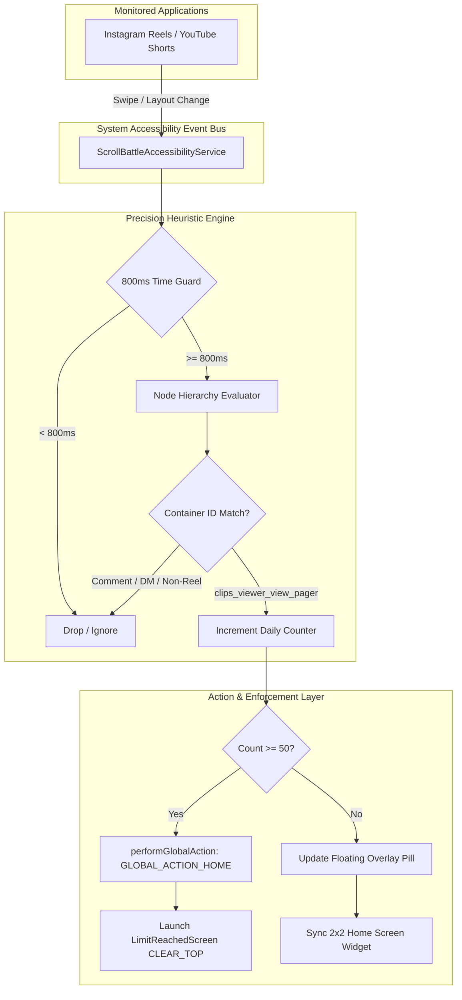

# 🧠 ScrollBattle — Open-Source Anti-Doomscroll Android Engine

[](https://opensource.org/licenses/MIT)
[-brightgreen.svg)](https://developer.android.com)
[](https://kotlinlang.org)
[](https://developer.android.com/jetpack/compose)
[](https://github.com/NIKHILSINGLAT/ScrollBattle)
[](https://github.com/NIKHILSINGLAT/ScrollBattle/pulls)

> **The adversarial, open-source Android engine that fights short-form video addiction with viewport-level node tracking, a strict 50-reels daily ceiling, and zero-bypass system force-ejection.**

---

## ⚡ The Problem: The Dopamine Trap & Wellbeing Failure

Short-form video feeds (**Instagram Reels, YouTube Shorts, Snapchat Spotlight**) are designed by teams of behavioral psychologists and machine learning engineers to maximize session duration through variable dopamine rewards and zero-friction vertical scrolling.

Traditional screen-time apps consistently fail because:
1. **The "Soft Dismissal" Fallacy**: They display passive popups with a single-tap *"Give me 15 more minutes"* button. By the time a user sees the alert, their prefrontal cortex is already depleted.
2. **App-Wide Blunt Hammers**: Blocking all of Instagram or YouTube cuts off vital messaging (DMs, family groups, business inquiries). Users simply disable the blocker.
3. **Inaccurate Scroll Detection**: Naive accessibility listeners count every touch, comment tap, like, and direct message as a video scroll, corrupting metrics and eroding user trust.

**ScrollBattle solves this.** It isolates **only short-form video ViewPagers**, tracks reel swipes with precision heuristics, maintains a floating on-screen counter, and **physically kicks you out of Instagram to the Android Home screen** the moment you exceed your daily allowance.

---

## ✨ Key Features

* 🔒 **Strict 50 Reels / Day Hardlock**: No custom limit pickers (25, 50, 75, 100 eliminated). When willpower is low, you cannot bargain or increase the limit.
* 🛑 **Instant Force-Ejection Kick-Out**: The millisecond you attempt to scroll reel #51, ScrollBattle executes `performGlobalAction(GLOBAL_ACTION_HOME)` to boot Instagram off your screen and launches `LimitReachedScreen` (`FLAG_ACTIVITY_CLEAR_TOP`). Re-launching Instagram triggers instant home ejection before video can stream.
* 🎯 **Reverse-Engineered Precision Heuristics**: Ported from commercial benchmarks (**BrainPal**) via **REA (Reverse Engineer Anything)**. Targets proprietary ViewPager container IDs (`clips_viewer_view_pager`, `clips_video_container`, `spotlight_container`).
* 🛡️ **Negative Filter Engine**: Taps, likes, comments (`layout_comment_thread_edittext`), DMs (`direct_thread_layout`), and profiles are strictly ignored.
* ⏱️ **800ms Debounce & Event Throttling**: Drops 60Hz content-change event floods from video renderers, eliminating CPU spikes, battery drain, and false multi-counts.
* 🎈 **Draggable Floating Counter Pill**: Real-time `[🧠 Count / 50]` overlay using `TYPE_APPLICATION_OVERLAY` that appears only when Reels are active, stays persistent, and can be smoothly dragged anywhere on screen.
* 🧩 **1-Tap Home Screen Buddy Widget**: 2x2 launcher widget displaying daily progress and mascot status with 1-tap auto-pinning via `AppWidgetManager.requestPinAppWidget()`.
* 🧠 **Cognitive Friction Recovery**: Want bonus reels? Solve gamified mental arithmetic challenges (`MathsChallengeScreen`) to force your prefrontal cortex back online.

---

## 🏗️ System Architecture



---

## 🔬 How Detection & Enforcement Works Under the Hood

### 1. ViewPager Container Isolation
Instead of blindly monitoring all scroll events in Instagram, `ScrollBattleAccessibilityService` recursively searches the `AccessibilityNodeInfo` tree for verified video ViewPagers:

```kotlin
private fun isReelsActive(node: AccessibilityNodeInfo?): Boolean {
    if (node == null) return false
    val id = node.viewIdResourceName ?: ""
    if (id.contains("clips_viewer_view_pager") ||
        id.contains("clips_video_container") ||
        id.contains("reel_viewer") ||
        id.contains("reel_player_page_content")) {
        return true
    }
    for (i in 0 until node.childCount) {
        if (isReelsActive(node.getChild(i))) return true
    }
    return false
}
```

### 2. Negative Filtering (Comments & DMs)
Tapping comments or sending DMs alters view layouts. ScrollBattle excludes these nodes to prevent false increments:

```kotlin
// Strictly ignore interaction overlays
if (id.contains("layout_comment_thread_edittext") ||
    id.contains("direct_thread_layout") ||
    id.contains("action_bar_container")) {
    return false
}
```

### 3. OEM Accessibility Resilience
Release builds on OEM skins (Samsung OneUI, Xiaomi HyperOS, Oppo/Realme ColorOS) mask view nodes deemed "unimportant". ScrollBattle configures native flags to preserve tree integrity:

```xml
<accessibility-service
    xmlns:android="http://schemas.android.com/apk/res/android"
    android:accessibilityEventTypes="typeViewScrolled|typeWindowContentChanged"
    android:accessibilityFeedbackType="feedbackGeneric"
    android:accessibilityFlags="flagDefault|flagRetrieveInteractiveWindows|flagIncludeNotImportantViews"
    android:canRetrieveWindowContent="true" />
```

### 4. Zero-Bypass Ejection
Non-rooted Android apps cannot kill third-party processes directly. ScrollBattle performs an instantaneous home evacuation:

```kotlin
private fun enforceLimitIfExceeded() {
    performGlobalAction(GLOBAL_ACTION_HOME)
    overlayManager.hidePill()

    val lockIntent = Intent(this, MainActivity::class.java).apply {
        flags = Intent.FLAG_ACTIVITY_NEW_TASK or Intent.FLAG_ACTIVITY_CLEAR_TOP
        putExtra("NAV_KEY", "limit_reached")
    }
    startActivity(lockIntent)
}
```

---

## 📱 Installation & Setup

### 1. Download APK
Download the latest pre-compiled release APK from the **[Releases](https://github.com/NIKHILSINGLAT/ScrollBattle/releases)** section.

### 2. Grant Required Permissions
ScrollBattle requires two specific permissions to monitor and protect focus:
1. **Accessibility Service**: Navigate to `Settings -> Accessibility -> Installed Apps -> ScrollBattle -> Enable`.
2. **Display over other apps**: Navigate to `Settings -> Apps -> Special App Access -> Display over other apps -> ScrollBattle -> Allow`.

---

## 🛠️ Building from Source

### Prerequisites
* **Android Studio** (Koala / Ladybug or newer)
* **JDK 17** or **JDK 21**
* **Android SDK** API 34+

### Clone & Build
```bash
# Clone the repository
git clone https://github.com/NIKHILSINGLAT/ScrollBattle.git
cd ScrollBattle

# Build debug APK
./gradlew assembleDebug

# Build production release APK
./gradlew assembleRelease
```
The compiled APK will be generated at:
`app/build/outputs/apk/debug/app-debug.apk`

---

## 📂 Project Structure

```
ScrollBattle/
├── app/
│   ├── build.gradle.kts           # Kotlin 2.0 & Jetpack Compose dependencies
│   └── src/main/
│       ├── AndroidManifest.xml    # Single package 'com.scrollbattle'
│       ├── res/
│       │   ├── xml/accessibility_service_config.xml # Accessibility flags
│       │   └── layout/widget_brainpal_buddy.xml     # 2x2 launcher widget
│       └── java/com/scrollbattle/
│           ├── MainActivity.kt                       # Single activity host
│           ├── Navigation.kt                         # Screen routing
│           ├── data/
│           │   └── DataRepository.kt                 # 50-reels hardlock & persistence
│           ├── service/
│           │   ├── ScrollBattleAccessibilityService.kt # ViewPager & Ejection engine
│           │   └── FloatingOverlayManager.kt          # Draggable overlay pill
│           ├── widget/
│           │   └── BrainPalWidgetProvider.kt         # Launcher widget & pinning
│           └── ui/
│               ├── ScrollBattleViewModel.kt          # Reactive state pipeline
│               └── screens/
│                   ├── HomeScreen.kt                 # Focus dashboard
│                   ├── BattleScreen.kt               # Active streak battle
│                   ├── LimitReachedScreen.kt         # Un-bypassable lock screen
│                   ├── MathsChallengeScreen.kt       # Cognitive friction test
│                   ├── SettingsScreen.kt             # Locked 50-reels config
│                   └── PermissionsSetupScreen.kt     # Onboarding setup flow
├── docs/
│   └── ARCHITECTURE_AND_JOURNEY.md # Full engineering journey & reverse-engineering case study
├── LICENSE                        # MIT License (100% Free & Open Source)
└── README.md
```

---

## 🤝 Contributing

Contributions are welcome! Whether it's adding support for more video platforms (TikTok, Reddit Reels, Twitter Video), improving accessibility performance, or designing new gamified friction challenges:

1. **Fork** the repository.
2. Create a feature branch (`git checkout -b feature/awesome-feature`).
3. Commit your changes (`git commit -m 'Add awesome feature'`).
4. Push to your branch (`git push origin feature/awesome-feature`).
5. Open a **Pull Request**.

---

## 📄 License

This project is licensed under the **MIT License** — completely free and open source. See the [LICENSE](LICENSE) file for details.

Developed with ❤️ by **[Nikhil Singla](https://github.com/NIKHILSINGLAT)** & pair-programmed with **Google Antigravity**.
